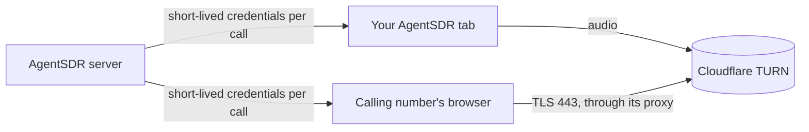

Cloudflare TURN relays the audio between your browser and a cloud calling number when you click **Call now** on a lead in an AI calling campaign. You need it for **Call now**. AI agent calls, recordings and everything else work without it.

<Info>
**What you need**

- A Cloudflare account. Cloudflare bills TURN traffic to you directly, with a free allowance each month. Check [Cloudflare's TURN docs](https://developers.cloudflare.com/realtime/turn/) for current pricing.
- The **owner** or **admin** role in AgentSDR.
- About 5 minutes.
</Info>

## Why a relay

A cloud calling number runs WhatsApp Web in a browser profile that reaches the internet only through the number's proxy, over TCP. Your browser and that browser cannot reach each other directly. Both connect to Cloudflare's TURN server instead: the calling number through its proxy, over TLS on port 443, and your browser directly.

AgentSDR keeps your TURN key on the server. For each call it asks Cloudflare for credentials that expire after 2 hours, separately for your tab and for the calling number. They are never stored.

## Connect Cloudflare TURN

<Steps>
  <Step title="Create a TURN key">
    In the [Cloudflare dashboard](https://dash.cloudflare.com/?to=/:account/calls), open **Realtime → TURN Server** and create a TURN key. Any name works, for example `agentsdr`. Cloudflare shows the key's ID and its API token. Copy both now. Store the token somewhere safe: you may not be able to see it again.
    {/* SCREENSHOT: TURN key created | dash.cloudflare.com, Realtime, TURN Server | the key ID and the API token */}
  </Step>
  <Step title="Open the Integrations page in AgentSDR">
    Go to **Settings → WhatsApp → Integrations**. On the **Cloudflare TURN** card, click **Connect**.
  </Step>
  <Step title="Fill in the two fields">
    | Field | Where the value is |
    |---|---|
    | **TURN key ID** | The key's ID from step 1, 32 letters and digits. |
    | **API token** | The key's API token from step 1. This is the TURN key's own token, not a Cloudflare account API token. |
  </Step>
  <Step title="Click Connect & test">
    AgentSDR asks Cloudflare for one set of credentials that expire after a minute. If Cloudflare answers with a relay, the card shows **Connected**.
  </Step>
</Steps>

## Check that it works

<Check>
The **Cloudflare TURN** card shows **Connected** and a **Last verified** time.
</Check>

To test end to end, open a lead in an AI calling campaign and click **Call now**, as described in [Talk through a calling number](/whatsapp/calling#talk-through-a-calling-number). The call bar moves past **Connecting your audio…** to **Calling…**.

## Troubleshooting

<AccordionGroup>
  <Accordion title="Cloudflare TURN didn't accept this key ID and API token">
    Cloudflare answered 401 or 403. The API token does not belong to this key, or it was revoked. Copy both values again from the same key, or create a new key.
  </Accordion>
  <Accordion title="Cloudflare TURN has no key with this ID">
    Cloudflare answered 404. Check the **TURN key ID** for typos, or that the key was not deleted.
  </Accordion>
  <Accordion title="Calls through a number need Cloudflare TURN">
    The call bar says this when this organization has not connected Cloudflare TURN. Nothing was queued. An owner or admin connects it as above.
  </Accordion>
  <Accordion title="Couldn't connect your audio to the number, even through the relay">
    Neither side reached the relay. Check that your own network allows outgoing HTTPS, then try again. If it keeps failing, the calling number's worker logs show which connections it gathered (`rep link: candidates`).
  </Accordion>
</AccordionGroup>

## Next

<CardGroup cols={2}>
  <Card title="WhatsApp calling" icon="phone" href="/whatsapp/calling">
    Place calls, and talk through a calling number.
  </Card>
  <Card title="Integrations overview" icon="plug" href="/integrations">
    All integrations and who can connect them.
  </Card>
</CardGroup>
